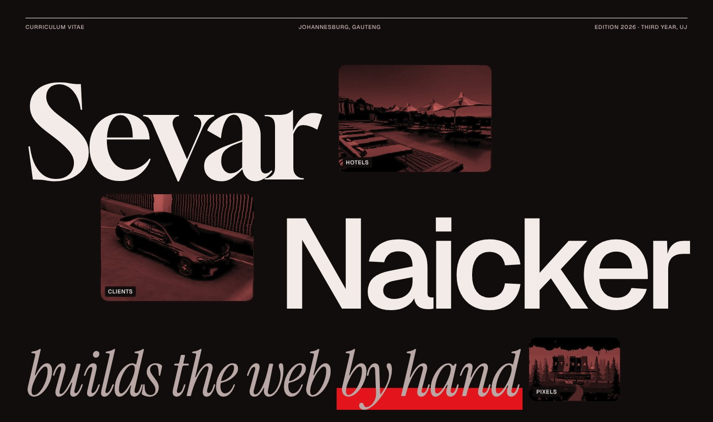

<h2 align="center">Sevar Naicker · CV</h2>

The source for my CV site, live at **[sevar-naicker.github.io](https://sevar-naicker.github.io)**.

I'm a third-year student developer at the University of Johannesburg. The site covers the websites I build for clients and friends, the applications I make for myself, and what I'm studying, with links to the live projects.

<h2 align="center">How It's Built</h2>

- One `index.html` file: plain HTML, CSS and JavaScript, no framework or build step
- [GSAP](https://gsap.com) with ScrollTrigger for the pinned scenes and scroll animations, and [Lenis](https://lenis.darkroom.engineering) for smooth scrolling
- Liquid wave section edges, a typed story section, a hover preview on each project, and a scroll progress bar
- Respects reduced motion: the animations switch off for anyone who has asked their device for less motion
- Hosted on GitHub Pages straight from this repo

<h2 align="center">Run It Locally</h2>

Download or clone the repo and open `index.html` in a browser. Nothing to install.

> Coding for people who can always reach me.
